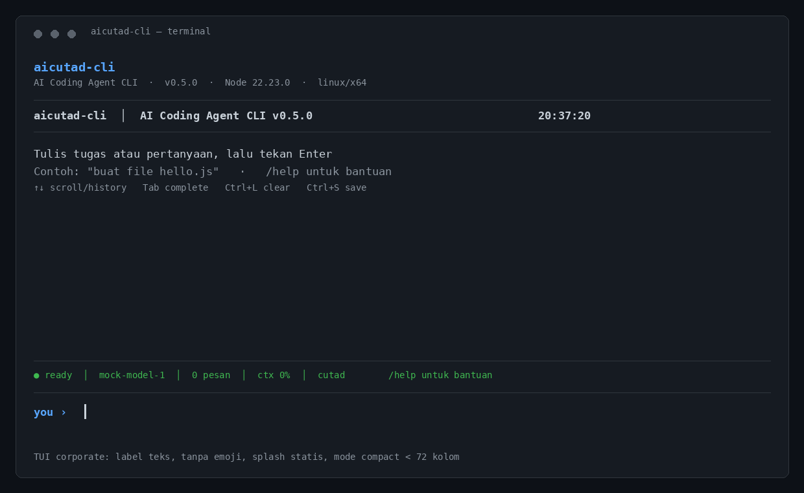

<div align="center">

# aicutad-cli

**AI Coding Agent CLI** - baca, tulis, edit file & jalankan command shell otonom lewat terminal.

Ditenagai gateway [ai.cutad.web.id](https://ai.cutad.web.id) · OpenAI-compatible `/v1`

[]()
[]()
[]()
[]()
[]()



</div>

---

## Apa itu?

**aicutad-cli** adalah AI coding agent yang jalan di terminal kamu. Bukan sekadar chat - ia **baca file, tulis kode, edit file, dan jalankan command shell sendiri** lewat agentic loop dengan function calling.

Kamu kasih tugas, agent bekerja otonom: baca → tulis → verifikasi → lapor.

```
$ aicutad agent "buat file hello.js berisi console.log hello world"

  aicutad-cli agent mode - v0.5.1
  model: deepseek-ai/deepseek-v4-pro  dir: /root/project

  > buat file hello.js berisi console.log hello world

  write Write (hello.js, 42 bytes)
  write Write ok (1 baris, syntax OK)
  read Read (hello.js)
  run Run (node hello.js) ok

  aicutad-cli selesai - 3 iterasi - 3 tools - 1.2s

  File hello.js berhasil dibuat & diverifikasi. Output: "Hello, World!"
```

## Instalasi

```bash
npm install -g aicutad-cli
```

Atau dari source:

```bash
git clone https://github.com/cutad/aicutad-cli.git
cd aicutad-cli
npm install -g .
```

**Persyaratan:** Node.js ≥ 22.12

## Mulai Cepat

```bash
aicutad
```

Pertama kali jalankan, **setup wizard** muncul otomatis:

1. **Boot animation** - bordered window, typewriter logo, system info
2. **Masukkan API key** (input tersembunyi `••••••••`)
3. **Validasi koneksi** ke gateway (animated spinner)
4. **Pilih model** (arrow-key ↑/↓ selector, clean UI)
5. **Simpan konfigurasi** ke `~/.cutad/auth.json`
6. **Langsung masuk TUI** full-screen

Setelah setup, `aicutad` langsung buka **TUI agent** - ketik tugas apa pun, agent kerjakan.

## Mode Agent

Setiap pesan di TUI = **agent**. Model selalu punya akses ke 6 tools:

| Tool | Icon | Fungsi |
|---|:---:|---|
| `read_file` | 📖 | Baca isi file |
| `write_file` | 📝 | Buat / overwrite file |
| `edit_file` | ✏️ | Find-and-replace di file |
| `list_files` | 📂 | Daftar file & direktori |
| `search_files` | 🔍 | Cari teks (regex) di kode |
| `run_command` | ⚡ | Jalankan command shell |
| `browse_page` | 🌐 | Buka URL di headless Chromium & ekstrak teks |
| `web_search` | 🔎 | Cari di Google, return 5 hasil teratas |
| `screenshot` | 📷 | Screenshot halaman web (PNG) |

**Alur agentic loop:**

```
User: "buat file fibonacci.js"
  → Model: write_file(fibonacci.js, ...)
  → Model: read_file(fibonacci.js)          // verifikasi
  → Model: run_command(node fibonacci.js)   // test
  → Model: lapor hasil ke user
```

Model memutuskan sendiri tool apa yang dipakai, berapa kali, dan kapan selesai. Maks 20 iterasi untuk safety.

## TUI Full-Screen

```
 aicutad-cli │ AI Coding Agent CLI v0.4.6          19:20:35
 ━━━━━━━━━━━━━━━━━━━━━━━━━━━━━━━━━━━━━━━━━━━━━━━━━━━━━━━━━━━━
 ┌─ you 19:20
 │ ada apa di sini
 └─
 📂 List /tmp/project …
 📂 List ✓ file hello.js, file utils.js
 📖 Read /tmp/project/hello.js …
 📖 Read ✓ console.log('Hello, World!')
 ┌─ aicutad-cli 19:20
 │ Di direktori ada 2 file: hello.js dan utils.js.
 │ hello.js berisi console.log('Hello, World!').
 │ Mau aku apain?
 └─
 ━━━━━━━━━━━━━━━━━━━━━━━━━━━━━━━━━━━━━━━━━━━━━━━━━━━━━━━━━━━━
 ● │ ready │ deepseek-ai/deepseek-v4-pro │ 6 pesan │ 1,835 tok │ $0.0010 │ ctx 2% │ cutad   /help
 you ›
```

### Fitur TUI v0.4.6

- **Splash singkat** - informasi versi & runtime, tanpa animasi berlapis
- **Full-screen** - alternate buffer, fokus hanya ke aicutad-cli
- **Zero-glitch rendering** - absolute positioning (no `\n` scroll), in-place updates untuk input/spinner/clock
- **Cost tracking live** - token count + biaya ($0.0010) tampil di status bar real-time
- **Context window indicator** - `ctx 15%` dengan color coding (dim/yellow/red)
- **Context window management** - auto-summarize pesan lama saat context >80%
- **Typing animation** - AI response muncul char-by-char
- **Interactive help modal** - arrow ↑/↓ navigasi, Enter pilih command, Esc tutup
- **Interactive model picker** - arrow keys, modal overlay
- **Input history** - ↑/↓ arrows recall pesan sebelumnya (saat input kosong = scroll pesan)
- **Keyboard shortcuts** - `Ctrl+L` clear, `Ctrl+S` save, `Tab` autocomplete
- **Modal overlays** - help, models, sessions, agents (centered bordered, glitch-free)
- **Live clock** - `HH:MM:SS` di header
- **Markdown rendering** - code blocks, bold, italic, headers, lists, blockquotes
- **Message timestamps** - `HH:MM` per message
- **Compact tool display** - inline 1-baris dengan icon + color + status
- **Status bar** - colored indicator (🟢 ready · 🟡 bekerja · 🔴 error · 🔵 scroll)
- **Spinner animation** - braille dots, 100ms smooth (in-place, no redraw)

### Keyboard Shortcuts

| Key | Fungsi |
|---|---|
| `↑` / `↓` | Scroll pesan (input kosong) / History navigasi (input ada) / Modal navigasi |
| `Tab` | Autocomplete command |
| `Ctrl+L` | Clear screen |
| `Ctrl+S` | Save session |
| `Ctrl+C` | Keluar |
| `Esc` | Tutup modal |
| `Enter` | Kirim pesan / Pilih item di modal |

### Command di TUI

| Command | Fungsi |
|---|---|
| `/help` | Bantuan (interactive modal - ↑/↓ navigasi, Enter pilih) |
| `/models` | Pilih model (interactive modal picker) |
| `/model <name>` | Ganti model langsung |
| `/agents` | Daftar subagent (modal overlay) |
| `/sessions` | Daftar session tersimpan (modal overlay) |
| `/save` | Simpan session |
| `/clear` | Bersihkan layar |
| `/exit` | Keluar |

## Command Line

```bash
# Agent otonom (CLI mode - output ke terminal)
aicutad agent "buat file utils.js berisi fungsi fibonacci"
aicutad agent "fix bug di app.js" --model deepseek-ai/deepseek-v4-pro --dir /path/to/project

# TUI full-screen (default)
aicutad

# Chat satu kali
aicutad chat "jelaskan apa itu closure"

# Chat interaktif (REPL)
aicutad chat

# Manajemen
aicutad login      # setup wizard
aicutad status     # cek status login + jumlah model
aicutad models     # daftar model dari gateway
aicutad agents     # daftar subagent
aicutad sessions   # daftar session tersimpan
aicutad mcp --list # daftar MCP server
aicutad doctor     # diagnostik lingkungan (tambah --offline / --json)
aicutad logout     # hapus kredensial (di TUI: /logout)
```

## Subagent

8 subagent bawaan untuk tugas spesifik:

| Agent | Role | Deskripsi |
|---|---|---|
| `cutad-build` | orchestrator | Implementasi fitur, bugfix, refactor |
| `cutad-architect` | architect | Desain sistem, ADR, dekomposisi komponen |
| `cutad-review` | reviewer | Code review multi-aspek (security, perf, API) |
| `cutad-debug` | debugger | Root-cause debugging 4 fase |
| `cutad-plan` | planner | Rencana implementasi terstruktur |
| `cutad-search` | researcher | Riset evidence-first dengan citations |
| `cutad-fe` | frontend | Frontend UI/UX (React, Vue, Svelte, CSS) |
| `cutad-droid` | android | Native Android (Kotlin, Compose, Room, Hilt) |

## Session Management

Percakapan otomatis tersimpan di `~/.cutad/sessions/`:

```bash
aicutad sessions          # daftar semua session
```

Di TUI: `/save` untuk simpan manual, `/sessions` untuk lihat daftar.

## MCP Support

aicutad-cli mendukung [Model Context Protocol](https://modelcontextprotocol.io) untuk extend tools:

```bash
aicutad mcp --list                    # daftar MCP server
aicutad mcp --add <name>              # tambah MCP server
aicutad mcp --connect <name>          # connect & list tools
aicutad mcp --remove <name>           # hapus MCP server
```

Config MCP disimpan di `~/.cutad/mcp.json`.

## Konfigurasi

Disimpan di `~/.cutad/`:

```
~/.cutad/
├── auth.json         # API key, model, gateway
├── sessions/         # riwayat percakapan
├── providers.json    # multi-gateway config
├── mcp.json          # MCP server config
└── plugins.json      # plugin config
```

**auth.json:**

```json
{
  "apiKey": "cag_...",
  "baseUrl": "https://ai.cutad.web.id/v1",
  "site": "https://ai.cutad.web.id",
  "model": "deepseek-ai/deepseek-v4-pro"
}
```

**Environment variables** (override, untuk CI/non-interaktif):

| Env | Fungsi |
|---|---|
| `CUTAD_API_KEY` | API key (skip prompt input) |
| `CUTAD_MODEL` | Model default (skip selector) |
| `CUTAD_BASE` | Base URL gateway |

```bash
# Login non-interaktif (CI/CD)
CUTAD_API_KEY=cag_... CUTAD_MODEL=deepseek-ai/deepseek-v4-pro aicutad login
```

## Enterprise / Corporate

Fitur untuk lingkungan organisasi & compliance:

**Profile terpisah** — pisahkan kredensial per lingkungan:

```bash
CUTAD_PROFILE=corp aicutad login     # config di ~/.cutad/profiles/corp/
CUTAD_PROFILE=corp aicutad agent "..."
```

**Policy (tool governance)** — batasi kemampuan agent lewat
`.aicutad/policy.json` di proyek atau `~/.cutad/policy.json`:

```json
{
  "workspaceOnly": true,
  "allowRunCommandInWorkspaceOnly": false,
  "allowedTools": ["read_file", "write_file", "edit_file", "list_files", "search_files"],
  "deniedTools": ["run_command"]
}
```

**Audit log** — semua eksekusi tool tercatat JSONL di `~/.cutad/audit.log`
(tanpa isi file/API key). Lihat dengan `aicutad audit --limit 20`,
matikan dengan `CUTAD_AUDIT_LOG=0`.

**Lainnya:**

- Proxy corporate: `HTTPS_PROXY`/`HTTP_PROXY`/`NO_PROXY` dihormati otomatis
- Telemetry: mati secara default; opt-in `CUTAD_TELEMETRY=1` + `CUTAD_TELEMETRY_URL` (hanya metadata, tanpa prompt/konten)
- Command destruktif diblokir default; override sadar: `CUTAD_ALLOW_DESTRUCTIVE=1`
- SBOM CycloneDX: `npm run sbom` • Keamanan: lihat `SECURITY.md` • Kontribusi: `CONTRIBUTING.md`

## Struktur Project

```
aicutad-cli/
├── bin/
│   └── cutad.mjs              # entrypoint (Commander, 8 subcommands)
├── src/
│   ├── tui/
│   │   └── App.mjs            # TUI native full-screen (ANSI, v0.4.6)
│   ├── agent/
│   │   ├── tools.mjs          # 9 tool definitions (function calling)
│   │   ├── executor.mjs       # eksekusi tool (read/write/edit/run/browse)
│   │   ├── loop.mjs           # agentic loop (model ↔ tool, max 20 iter)
│   │   ├── context.mjs        # context window management (auto-summarize)
│   │   ├── cost.mjs           # cost tracking (token usage per session)
│   │   ├── browser.mjs        # headless Chromium (Puppeteer)
│   │   ├── run.mjs            # CLI entrypoint agent mode
│   │   └── index.mjs          # 8 subagent + delegate parallel/chain
│   ├── session/
│   │   └── index.mjs          # save/load/list/export/import
│   ├── mcp/
│   │   └── index.mjs          # MCP client (connect, list tools, call)
│   ├── provider/
│   │   └── index.mjs          # multi-gateway config & switching
│   ├── plugin/
│   │   └── index.mjs          # load external modules
│   ├── api.mjs                # gateway komunikasi (models + chat)
│   ├── chat.mjs               # REPL + TUI launcher
│   ├── commands.mjs           # login wizard / status / logout
│   ├── config.mjs             # baca/tulis auth
│   ├── constants.mjs          # URL & konstanta
│   ├── models.mjs             # daftar model
│   ├── prompt.mjs             # masked input + arrow selector (glitch-free)
│   └── ui.mjs                 # UI toolkit (banner, panel, spinner)
├── .github/workflows/
│   ├── ci.yml                 # CI test (Node 22/24)
│   └── publish.yml            # Auto-publish to npm on release
├── .gitignore
├── package.json
└── README.md
```

## Teknologi

- **Runtime:** Node.js ≥ 22.12 (ESM)
- **Gateway:** ai.cutad.web.id (OpenAI-compatible `/v1`)
- **Function calling:** OpenAI tools API (`tools` + `tool_choice: auto`)
- **TUI:** Native ANSI control codes (no React/Ink dependency)
- **Rendering:** Absolute positioning (zero-scroll) + in-place updates untuk input/spinner/clock
- **Dependencies:** `commander` (CLI), `picocolors` (color), `@modelcontextprotocol/sdk` (MCP), `puppeteer` (browser)
- **Package size:** 46.7 KB (4 deps)

## Roadmap

### Done (v0.4.6)

- [x] **Published to npm** - `npm install -g aicutad-cli` ✅
- [x] TUI full-screen (alternate buffer)
- [x] Splash statis singkat
- [x] Agentic loop dengan function calling (9 tools)
- [x] **Context window management** - auto-summarize old messages (>80% threshold)
- [x] **Cost tracking** - token usage & estimasi biaya per session, tampil di status bar
- [x] **Context window indicator** - `ctx 15%` live di status bar dengan color coding
- [x] **Headless browser tools** - Chromium (browse, search, screenshot)
- [x] **Zero-glitch rendering** - absolute positioning (no `\n` scroll), in-place updates
- [x] **Interactive help modal** - arrow ↑/↓ navigasi, Enter pilih command
- [x] **Scroll messages** - arrow ↑/↓ saat input kosong untuk scroll percakapan
- [x] Typing animation (AI response char-by-char)
- [x] Interactive model picker (modal overlay, arrow keys)
- [x] Input history (↑/↓ arrows)
- [x] Keyboard shortcuts (Ctrl+L, Ctrl+S, Tab autocomplete)
- [x] Modal overlays (help, models, sessions, agents - glitch-free)
- [x] Live clock di header
- [x] Markdown rendering (code blocks, bold, italic, headers, lists)
- [x] Message timestamps
- [x] Session management (save/load/list)
- [x] 8 subagent + delegate parallel/chain
- [x] MCP client support
- [x] Multi-provider config (modul internal; switching via auth belum diekspos ke CLI)
- [x] Plugin system (modul internal; belum diekspos ke CLI)
- [x] First-run wizard
- [x] CI/CD (GitHub Actions)
- [x] Login wizard dengan animated spinner & progress bar

### Next Priority

- [ ] **Streaming response (SSE)** - TUI shows answer token-by-token
- [ ] **GitHub PR integration** - auto create branch, commit, push, open PR

### Future

- [ ] Headless server + web interface
- [ ] Diff viewer in TUI (show file changes before apply)
- [ ] Multi-file editing in single tool call
- [ ] Voice input (TTS/STT integration)
- [ ] Custom tool plugins (user-defined tools)
- [ ] Model-specific routing (different models for different tasks)

## License

MIT © [cutad](https://github.com/cutad)
